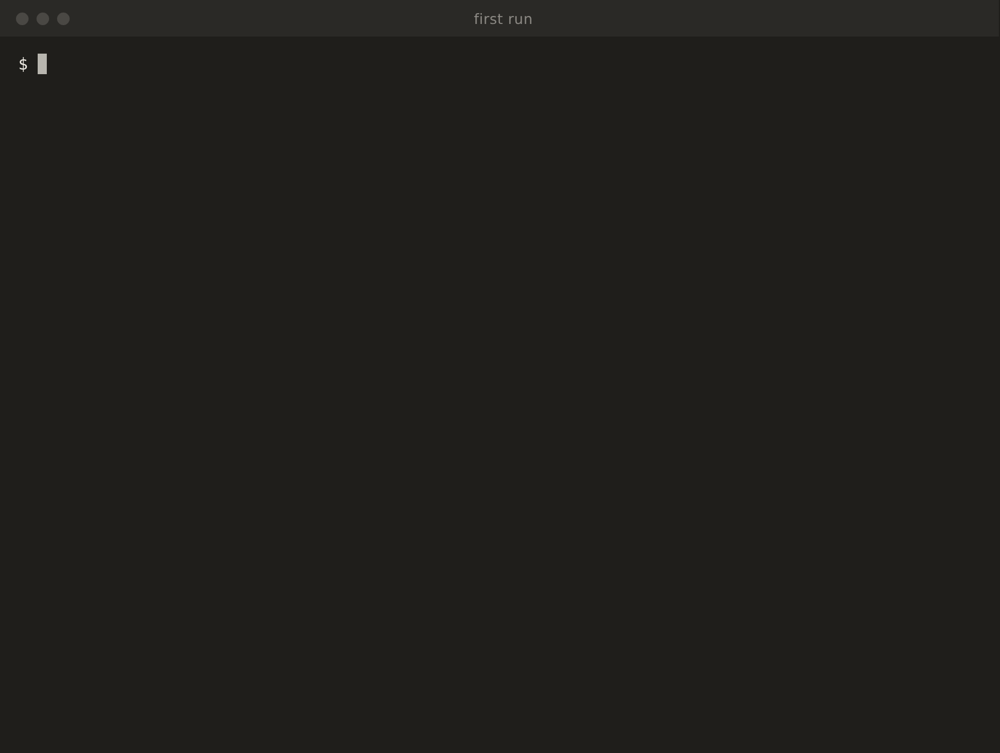
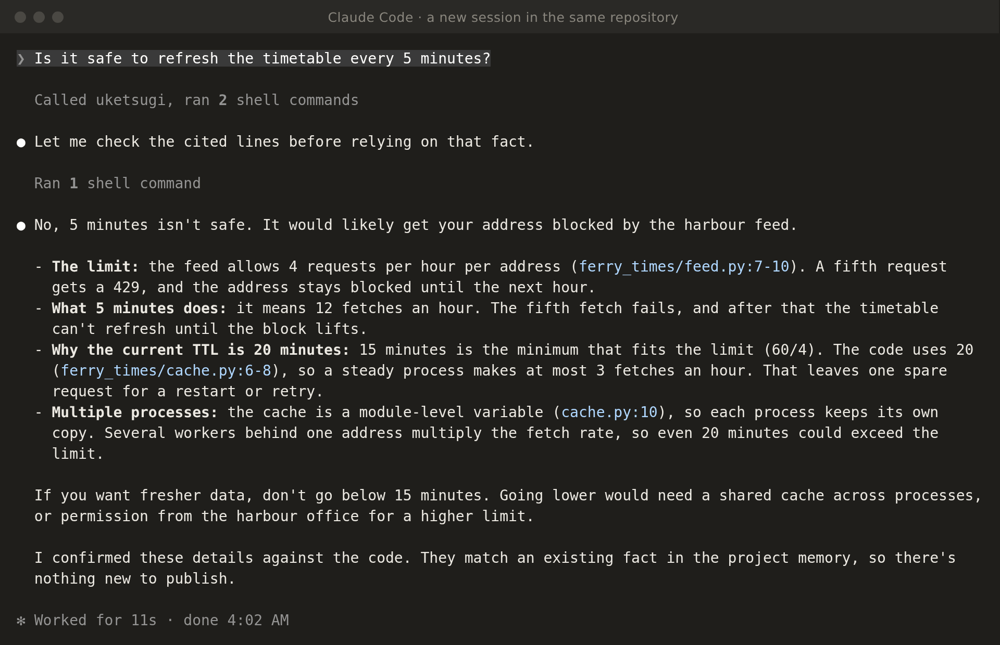

<p align="center">
  <picture>
    <source media="(prefers-color-scheme: dark)" srcset="assets/hero-dark.svg">
    
  </picture>
</p>

<h1 align="center">Uketsugi <sub>受け継ぎ</sub></h1>

<p align="center">
  <strong>Memory and task handoff for AI coding agents:<br>across sessions, across agents, across vendors.</strong>
</p>

Uketsugi is a shared memory for AI coding agents, and a way for them to hand work to one another.
What one agent works out about your code is there for the next one, whichever vendor's harness it
runs in and whenever it starts. Work that one agent began can be picked up by another.

The name is Japanese, 受け継ぎ: handing on, taking over from someone.

It is a small server that agents reach over [MCP](https://modelcontextprotocol.io), and you run it
yourself. One install on your own machine needs nothing else set up; the same server can be shared
by several people.

> **Pre-release (0.1.0).** Uketsugi runs on Linux x86-64 today. It has been run end to end with
> two harnesses, Claude Code and Antigravity: each found what the other had recorded, and each
> finished a task the other had left. It is built for any harness that can add an MCP server by
> its URL, and [connecting one](#another-mcp-client) takes a URL and a token. Commands, and what
> is stored, may still change between versions.

## How it works

<p align="center">
  <picture>
    <source media="(prefers-color-scheme: dark)" srcset="assets/steps-dark.svg">
    
  </picture>
</p>

- **An agent writes down what it establishes.** A fact is one claim with at least one citation (a
  file and its lines, a commit, a URL) and the question it answers. Before a fact is stored it is
  scanned, and anything recognised as a credential is replaced with a marker such as
  `[redacted:github-token]`.
- **The next agent looks before it digs.** A search returns the facts that match, their citations
  to check, and how confident the match is. With the embedding model installed, a question can
  find a fact that answers it in other words.
- **Unfinished work becomes a task.** An agent that takes a task holds a lease on it, so a second
  agent is told it is taken rather than doing it twice. It can leave notes, hand the task over
  with a note for whoever is next, or finish it. A task can be left for another repository.
- **A new session starts with a brief.** It says what is open, how your last session here ended
  and what the project already knows. With the Claude Code plugin the agent has it before your
  first prompt; elsewhere it comes with the first answer it gets from Uketsugi.
- **You can see all of it.** A small dashboard shows the facts, the tasks and what each session
  did, project by project.

A project is its repository's origin remote, `host/owner/name`. An agent passes it on every call.
A directory without one needs [a name of its own](#a-directory-with-no-origin-remote).

## Quickstart

For Linux on x86-64, checked on Ubuntu 22.04 and in a Debian 13 container. You need `curl`, `tar`
and `sha256sum`. No root, and no Node.js: the release brings its own runtime and leaves any Node
you have alone.

**1. Install**

```sh
curl -fsSL https://github.com/uketsugi/uketsugi/releases/download/v0.1.0/install.sh | sh
```

The script downloads one archive of 56 MB from the same release, checks it against the SHA-256 it
carries, unpacks it to `~/.local/lib/uketsugi` (about 170 MB) and puts the `ukt` command in
`~/.local/bin`. Nothing else is written. If it says `~/.local/bin` is not on your `PATH`, run the
two lines it prints: one for this shell, one for new ones.

**2. Set up**

```sh
ukt setup
```

This makes the data directory, `~/.local/share/uketsugi`, and a token for your harness. It also
installs the embedding model that lets search match meaning: a download of about 170 MB from the
npm registry and Hugging Face, each file checked against a pinned hash. `ukt setup --no-model`
leaves the model out, and search then matches words only.

**3. Start the server**

```sh
ukt serve
```

It serves `http://127.0.0.1:7410` in the foreground until you press Ctrl-C, so give it a terminal
of its own. From another terminal, `ukt doctor` checks the data directory, the token, the server,
the store and the model, and says what to do about anything that is wrong.

<!-- first-run:start -->

<p align="center">
  
</p>
<p align="center"><sub>Steps 1 to 3 in a fresh Debian 13 container. Pauses are shortened and the two downloads are shown faster than they ran.</sub></p>

<!-- first-run:end -->

**4. Connect Claude Code**

In another terminal:

```sh
claude plugin install uketsugi --marketplace ~/.local/lib/uketsugi/plugins \
  --config url=http://127.0.0.1:7410
printf '{"token":"%s"}' "$(ukt token)" | claude plugin configure uketsugi@uketsugi --values-stdin
```

The first command installs the plugin that came with the release. The second gives it your token
on standard input, so the token is never on a command line; Claude Code keeps it with its own
sign-in. That is all, and you work as you always do. The plugin adds the server to Claude Code,
and from the next session on:

- **The agent starts with the session's brief**, before your first prompt, and is told to search
  Uketsugi before investigating how or why something works, and to publish what it establishes,
  with a citation.
- **Where each turn ended is kept**: the agent's last message, scanned like everything else and
  private to you. A session you quit, or one that is killed, still tells the next one where it
  stopped.

The plugin talks to the server from Claude Code's hooks, which need `sh`, `curl` and `git`. A
hook that cannot reach the server does nothing, and the session goes on without it.

The plugin is installed for your user, so this holds for every Claude Code session under that
configuration, in every repository. When a session starts, the server is sent the repository's
origin remote. When a turn ends, it is sent the agent's last message, and keeps the first 4,000
characters the scan leaves. On your own machine that goes no further than your own server.

<details>
<summary>Without the plugin</summary>

Add the server by its URL:

```sh
export UKT_TOKEN="$(ukt token)"
claude mcp add --transport http --scope user uketsugi http://127.0.0.1:7410/mcp \
  --header "Authorization: Bearer $UKT_TOKEN"
```

Then start Claude Code in a repository and type `/uketsugi:setup`. This asks the agent to put a
short block at the top of your user-level instruction file: `~/.claude/CLAUDE.md`, or `CLAUDE.md`
in the folder `CLAUDE_CONFIG_DIR` names if you have set one. Claude Code may ask you to approve
the edit. It is the agent that writes the file, so look afterwards and see that the block is
there; the dashboard's Connect page shows it. A session then gets its brief with its first answer
from Uketsugi, and leaves no note of where it stopped.

If you connected this way before and now install the plugin, take the old set-up out first:
`claude mcp remove uketsugi -s user`, and delete the block from the instruction file.

</details>

### Antigravity

```sh
agy mcp add --header "Authorization: Bearer $(ukt token)" uketsugi http://127.0.0.1:7410/mcp
agy plugin install ~/.local/lib/uketsugi/plugins/antigravity
```

The first command adds the server; Antigravity keeps the token in
`~/.gemini/config/mcp_config.json`. The second installs a plugin that is one rule, always on: the
same instruction to search before investigating and to publish what is established. A session
gets its brief with its first answer from Uketsugi.

### Another MCP client

Any client that takes a remote MCP server by its URL can use the same server:

- **URL:** `http://127.0.0.1:7410/mcp`, over Streamable HTTP.
- **Header:** `Authorization: Bearer <token>`. `ukt token` prints the token. On the server's own
  machine, while you are its only person, the header can be left out.
- **Tools it will find:** `search_facts`, `publish_fact`, `update_fact`, `search_tasks`,
  `publish_task`, `claim_task` and `update_task`.

An agent uses the tools once its instructions say so: copy the block from the Connect page to the
top of the client's instruction file.

### A directory with no origin remote

An agent names its project by the repository's origin remote. In a directory that is not a
repository, or a repository with no origin, it has no name to give and gets no memory. For work
there, make a project name on the dashboard's Projects page. The page then shows a line to put in
that directory's instruction file (`CLAUDE.md` for Claude Code), such as:

```
The uketsugi project for this directory is `me/harbour-notes`.
```

## What you will see

Ask your agent something about the code. It searches first, finds nothing, works the answer out
and publishes it. Then start a new session and ask again:

<p align="center">
  
</p>
<p align="center"><sub>A new Claude Code session in the same repository. Nothing was typed before the question.</sub></p>

`ukt ui` opens the dashboard in your browser, already signed in. (`ukt ui --no-open` prints the
link instead; it works once.)

<p align="center">
  <picture>
    <source media="(prefers-color-scheme: dark)" srcset="assets/dashboard-facts-dark.png">
    
  </picture>
</p>
<p align="center">
  <picture>
    <source media="(prefers-color-scheme: dark)" srcset="assets/dashboard-handoff-dark.png">
    
  </picture>
</p>
<p align="center"><sub>From Claude Code and Antigravity sessions on two small made-up repositories. The task shown beside the list was left by one harness and finished by the other.</sub></p>

## Your data

Everything is on your machine, in three places:

| Path                      | What it holds                                                                                      |
| ------------------------- | -------------------------------------------------------------------------------------------------- |
| `~/.local/share/uketsugi` | The store, the token, the embedding model and `backups/`. `--data-dir` or `UKT_DATA_DIR` moves it. |
| `~/.local/lib/uketsugi`   | The installed release.                                                                             |
| `~/.local/bin/ukt`        | The command.                                                                                       |

The server listens on `127.0.0.1` only, unless you start it with `--host`.

- `ukt backup` writes the whole store to one file, while the server runs. `ukt restore <file>`
  puts it back, with the server stopped.
- `ukt export --markdown <folder>` writes every project's facts as Markdown, one file a project.
- Redacting a fact on the dashboard takes its text out of the dashboard, out of search and out of
  later exports. It does not reach the store's own files or a backup, even one made afterwards.
  If the text was a secret, change the secret as well.
- `ukt token --rotate` replaces your token, with the server stopped. A harness keeps the token it
  was given, so give it the new one: for Claude Code, the second command of step 4 again; for
  Antigravity, `agy mcp remove uketsugi`, then its first command again.

To remove Uketsugi, take it out of your harnesses, stop the server and delete those three paths:

```sh
claude plugin marketplace remove uketsugi
agy plugin uninstall uketsugi && agy mcp remove uketsugi
rm -rf ~/.local/share/uketsugi ~/.local/lib/uketsugi ~/.local/bin/ukt
```

The first command uninstalls the Claude Code plugin with the token it was given. If you connected
Claude Code without the plugin, it is `claude mcp remove uketsugi -s user` instead, and the block
between `<!-- uketsugi:start -->` and `<!-- uketsugi:end -->` in your instruction file is yours to
delete.

## Sharing a server

The same server serves several people. Whoever runs it adds each of them:

```sh
ukt invite Aiko --operator-name Ren
```

That prints a harness token and a dashboard key for the new person, once. Everything a person's
agents publish is private to that person until they share the project, which they do themselves
on the dashboard's Projects page. Sharing shows the others their facts there that carry a citation
that can be looked up, and their tasks, under their name. `ukt people` lists who is on the server and
`ukt revoke <id>` ends one token or key.

A server that listens only on its own machine takes its one person's harnesses there by its
address alone. From the first person you add, every harness sends a token, yours included, and
the same holds for a server that listens beyond its machine. A proxy or a tunnel on the same
machine can look like a local program to the server: it recognises the ones that say a request
was forwarded, and not every one does. Before you put one in front of a server that you alone
use, start it with `ukt serve --require-token`.

To reach it from other machines, start it with `ukt serve --host 0.0.0.0 --allowed-host <name>`.
It answers only to the names it is given, and it speaks plain HTTP, so put it behind a proxy that
terminates TLS.

A person you invited installs nothing of Uketsugi's but a plugin for their harness, which the
server hands out. With the server at `https://memory.example.com` and their token in `UKT_TOKEN`, Claude
Code is connected by:

```sh
claude plugin install uketsugi --marketplace https://memory.example.com/plugins/marketplace.json \
  --config url=https://memory.example.com
printf '{"token":"%s"}' "$UKT_TOKEN" | claude plugin configure uketsugi@uketsugi --values-stdin
```

The dashboard's Connect page shows these lines with the server's own address in them, and the
ones for Antigravity. After the server is upgraded, `claude plugin update uketsugi@uketsugi`
fetches the plugin that goes with it.

With the Claude Code plugin, what it sends goes to your server from every repository that person
works in: each one's origin remote, and the agent's last message of each turn. Nobody else on the
server is shown them, but they rest in a database you run. Tell the people you invite. One who
does not want that adds the server by its URL instead, without the plugin.

## From source

The code is a TypeScript workspace. It needs Node.js 24.21 or newer in the 24 line, and pnpm 9.

```sh
pnpm install
pnpm check                          # types, lint, formatting, tests
pnpm ukt serve --data-dir ./data    # the server, run from source
deploy/build.sh                     # the release archive and its install.sh, in deploy/dist
```

## Licence

Apache-2.0: see [LICENSE](LICENSE). [NOTICE](NOTICE) lists what is included from other projects.
