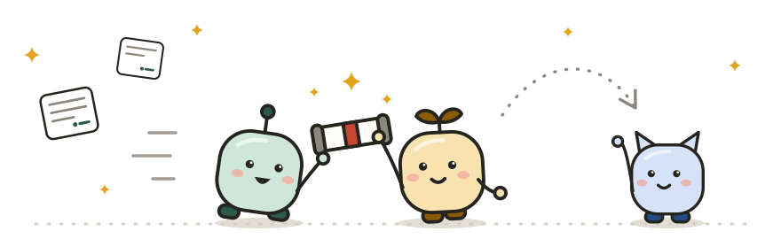
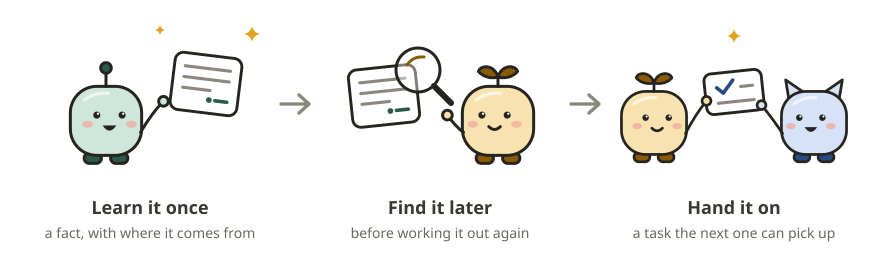
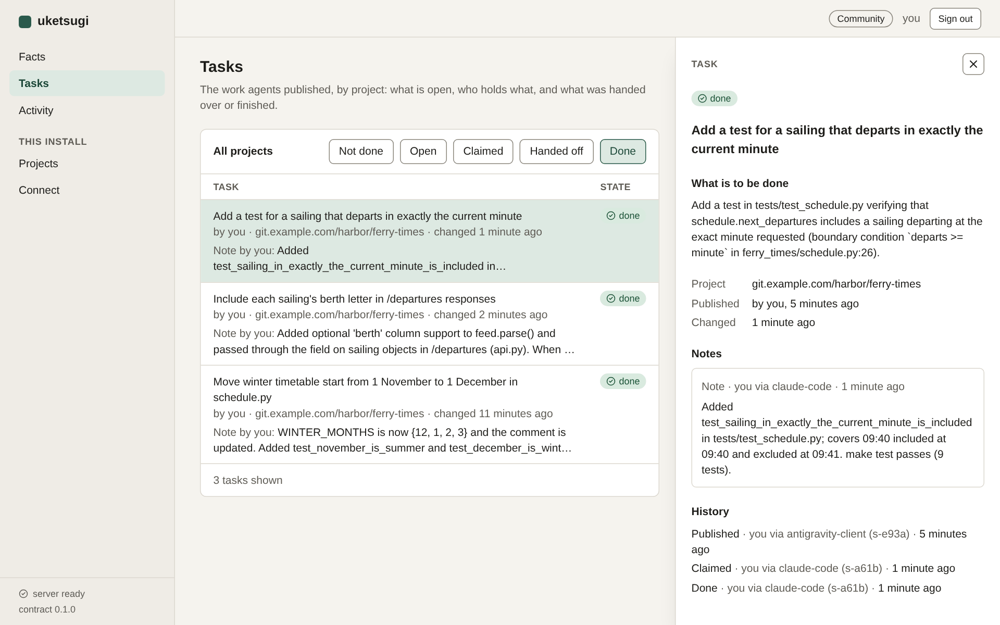

<p align="center">
  <picture>
    <source media="(prefers-color-scheme: dark)" srcset="assets/hero-dark.svg">
    
  </picture>
</p>

<h1 align="center">Uketsugi <sub>受け継ぎ</sub></h1>

<p align="center">
  <strong>Memory and task handoff for AI coding agents:<br>across sessions, across agents, across vendors.</strong>
</p>

Uketsugi is a shared memory for AI coding agents, and a way for them to hand work to one another.
What one agent works out about your code is there for the next one, whichever vendor's harness it
runs in and whenever it starts. Work that one agent began can be picked up by another.

The name is Japanese, 受け継ぎ: handing on, taking over from someone.

It is a small server that agents reach over [MCP](https://modelcontextprotocol.io), and you run it
yourself. One install on your own machine needs nothing else set up; the same server can be shared
by several people.

> **Pre-release (0.1.0).** Uketsugi runs on Linux x86-64 today. It has been run end to end with
> two harnesses, Claude Code and Antigravity: each found what the other had recorded, and each
> finished a task the other had left. It is built for any harness that can add an MCP server by
> its URL, and [connecting one](#another-mcp-client) takes its URL. Commands, and what
> is stored, may still change between versions.

## How it works

<p align="center">
  <picture>
    <source media="(prefers-color-scheme: dark)" srcset="assets/steps-dark.svg">
    
  </picture>
</p>

- **An agent writes down what it establishes.** A fact is one claim with at least one citation (a
  file and its lines, a commit, a URL) and the question it answers. Before a fact is stored it is
  scanned, and anything recognised as a credential is replaced with a marker such as
  `[redacted:github-token]`.
- **The next agent looks before it digs.** A search returns the facts that match, their citations
  to check, and how confident the match is. With the embedding model installed, a question can
  find a fact that answers it in other words.
- **Unfinished work becomes a task.** An agent that takes a task holds a lease on it, so a second
  agent is told it is taken rather than doing it twice. It can leave notes, hand the task over
  with a note for whoever is next, or finish it. A task can be left for another repository.
- **A new session starts with a brief.** It says what is open, how your last session here ended
  and what the project already knows. With the Claude Code plugin the agent has it before your
  first prompt; elsewhere it comes with the first answer it gets from Uketsugi.
- **You can see all of it.** A small dashboard shows the facts, the tasks and what each session
  did, project by project.

A project is its repository's origin remote, `host/owner/name`. An agent passes it on every call.
A directory without one needs [a name of its own](#a-directory-with-no-origin-remote).

## Quickstart

For Linux on x86-64, checked on Ubuntu 22.04 and in a Debian 13 container. You need `curl`, `tar`
and `sha256sum`. No root, and no Node.js: the release brings its own runtime and leaves any Node
you have alone.

**1. Install**

```sh
curl -fsSL https://github.com/uketsugi/uketsugi/releases/download/v0.1.0/install.sh | sh
```

The script downloads one archive of 56 MB from the same release, checks it against the SHA-256 it
carries, unpacks it to `~/.local/lib/uketsugi` (about 170 MB) and puts the `ukt` command in
`~/.local/bin`. Nothing else is written. If it says `~/.local/bin` is not on your `PATH`, run the
two lines it prints: one for this shell, one for new ones. Run over an earlier release, it replaces
it and, without asking, restarts your service (if you have one) on the new one: your harnesses
lose their connection for a moment.

**2. Set up**

```sh
ukt setup
```

This makes the data directory, `~/.local/share/uketsugi`, and your token. It then shows what else
it would do, and where, and asks once:

- **The embedding model**, which lets search match meaning: a download of about 170 MB from the
  npm registry and Hugging Face, each file checked against a pinned hash. Without it search
  matches words only. It goes into the data directory. The service does not see a
  `UKT_MODEL_DIR` of your shell: set-up says so, and the model must then be in the data directory.
- **A service**: one unit of your own systemd user manager,
  `~/.config/systemd/user/uketsugi.service`, which runs the server at `http://127.0.0.1:7410`,
  starts it when you log in and starts it again if it stops. Set-up writes that file and
  the link the manager makes to it in `~/.config/systemd/user/default.target.wants`: nothing else
  outside the data directory. No root, and no secret in it. A server that fails five times in
  five minutes is not started again until `systemctl --user reset-failed uketsugi`.

When it has started the server it checks that it is yours, asks it for its tools as a harness
would and reads its store (this leaves nothing behind), then ends
with the address and what to type for each harness. Set-up runs no harness command and writes no
harness file.

`ukt setup --plan` prints the plan, the unit in full, and changes nothing; `--yes` does all of it
without asking; `--no-model` and `--no-service` leave a part out. Run again, set-up changes
nothing that is in place and repairs what is not. Where nobody can be asked, as in a script, it
makes the data directory and installs the model, and leaves the service to a run with `--yes`.

The service is yours to run:

```sh
systemctl --user stop uketsugi      # and start, restart, status
journalctl --user -u uketsugi       # what the server printed
```

It runs while you are logged in to the machine. `loginctl enable-linger` keeps it running after
you log out; set-up tells you when that is off, and does not change it. `ukt doctor` checks the
data directory, the token, the service, the server, the store and the model, says what to do
about anything that is wrong, and prints again what to type for each harness.

**Without systemd**

In a container, or in a shell that cannot reach your service manager (one entered with `su`),
set-up says so and installs no service. Start the server yourself and give it a terminal of its
own:

```sh
ukt serve
```

It serves `http://127.0.0.1:7410` in the foreground until you press Ctrl-C.

<!-- first-run:start -->

<p align="center">
  
</p>
<p align="center"><sub>The install line, <code>ukt setup</code> and <code>ukt serve</code> in a fresh Debian 13 container, which has no systemd, recorded with 0.1.0: set-up prints more now, and a machine with systemd has no separate serve step. Pauses are shortened and the two downloads are shown faster than they ran.</sub></p>

<!-- first-run:end -->

**3. Add the server to a harness**

Each harness takes the server by its address, and one command is typed in a session. On a server
that only your machine reaches and that has you as its one person, no token is involved.

Claude Code:

```sh
claude mcp add --transport http --scope user uketsugi http://127.0.0.1:7410/mcp
```

Then start a session in a repository and type `/uketsugi:activate`. It writes nothing: it
tells the agent in that session to search Uketsugi before investigating and to publish what it
establishes, and you type it again in the next session. `/uketsugi:setup` asks the agent to
put a short block at the top of your user-level instruction file, `~/.claude/CLAUDE.md` (or
`CLAUDE.md` in the folder `CLAUDE_CONFIG_DIR` names), so that every later session does without
the command. Claude Code may ask you to approve the edit. It is the agent that writes the file, so
look afterwards and see that the block is there. In print mode (`claude -p`) the commands are
`/mcp__uketsugi__activate` and `/mcp__uketsugi__setup`, and the server's tools must be allowed
with `--allowedTools mcp__uketsugi`.

Antigravity:

```sh
agy mcp add uketsugi http://127.0.0.1:7410/mcp
```

Antigravity offers no server commands, so put the block that the dashboard's Connect page shows at
the top of `~/.gemini/GEMINI.md`.

Codex and VS Code:

```sh
codex mcp add uketsugi --url http://127.0.0.1:7410/mcp
code --add-mcp '{"name":"uketsugi","type":"http","url":"http://127.0.0.1:7410/mcp"}'
```

Cursor has no command for it: in `~/.cursor/mcp.json`, under `"mcpServers"`, add
`"uketsugi": {"url": "http://127.0.0.1:7410/mcp"}`, and approve the server when its agent asks.
For these three, the lines were run and no session was: put the block at the top of the
instruction file the harness reads.

`ukt setup` and `ukt doctor` print these lines for the server as it runs, and the Connect page
shows the same, with the lines that carry a token where the server asks for one. A session gets
its brief with the first answer it gets from Uketsugi.

### The plugin, as an extra

A harness can also take a plugin that the release ships. Nothing needs it, and set-up never
installs it. For Claude Code it adds the server too, so use it instead of the `claude mcp add`
line:

```sh
claude plugin install uketsugi --marketplace ~/.local/lib/uketsugi/plugins \
  --config url=http://127.0.0.1:7410
```

From the next session on, in every repository:

- **The agent starts with the session's brief**, before your first prompt, and is told to search
  Uketsugi before investigating how or why something works, and to publish what it establishes,
  with a citation. Nothing is typed.
- **Where each turn ended is kept**: the agent's last message, scanned like everything else and
  private to you. A session you quit, or one that is killed, still tells the next one where it
  stopped. The plugin also tells the server the repository's origin remote, which names the
  project.

The plugin talks to the server from Claude Code's hooks, which need `sh`, `curl` and `git`. A
hook that cannot reach the server does nothing, and the session goes on without it. Of the agent's
last message the server keeps the first 4,000 characters the scan leaves. On your own machine none
of this goes further than your own server. Where a token is needed, a second line gives it to the
plugin on standard input, so that it is never on a command line:

```sh
printf '{"token":"%s"}' "$(ukt token)" | claude plugin configure uketsugi@uketsugi --values-stdin
```

For Antigravity the plugin is one rule, always on: the same instruction. Add the server first,
then:

```sh
agy plugin install ~/.local/lib/uketsugi/plugins/antigravity
```

### Another MCP client

Any client that takes a remote MCP server by its URL can use the same server:

- **URL:** `http://127.0.0.1:7410/mcp`, over Streamable HTTP.
- **Header:** `Authorization: Bearer <token>`, where the server asks for one (see
  [Sharing a server](#sharing-a-server)). `ukt token` prints it. On the server's own machine,
  while you are its only person, the header is left out.
- **Tools it will find:** `search_facts`, `publish_fact`, `update_fact`, `search_tasks`,
  `publish_task`, `claim_task` and `update_task`.

An agent uses the tools once its instructions say so: copy the block from the Connect page to the
top of the client's instruction file.

### A directory with no origin remote

An agent names its project by the repository's origin remote. In a directory that is not a
repository, or a repository with no origin, it has no name to give and gets no memory. For work
there, make a project name on the dashboard's Projects page. The page then shows a line to put in
that directory's instruction file (`CLAUDE.md` for Claude Code), such as:

```
The uketsugi project for this directory is `me/harbour-notes`.
```

## What you will see

Ask your agent something about the code. It searches first, finds nothing, works the answer out
and publishes it. Then start a new session and ask again:

<p align="center">
  
</p>
<p align="center"><sub>A new Claude Code session in the same repository. Nothing was typed before the question.</sub></p>

`ukt ui` opens the dashboard in your browser, already signed in. (`ukt ui --no-open` prints the
link instead; it works once.)

<p align="center">
  <picture>
    <source media="(prefers-color-scheme: dark)" srcset="assets/dashboard-facts-dark.png">
    
  </picture>
</p>
<p align="center">
  <picture>
    <source media="(prefers-color-scheme: dark)" srcset="assets/dashboard-handoff-dark.png">
    
  </picture>
</p>
<p align="center"><sub>From Claude Code and Antigravity sessions on two small made-up repositories. The task shown beside the list was left by one harness and finished by the other.</sub></p>

## Your data

Everything is on your machine:

| Path                                      | What it holds                                                                                                                                      |
| ----------------------------------------- | -------------------------------------------------------------------------------------------------------------------------------------------------- |
| `~/.local/share/uketsugi`                 | The store, the token, how the server is set to run (`settings.json`), the embedding model and `backups/`. `--data-dir` or `UKT_DATA_DIR` moves it. |
| `~/.local/lib/uketsugi`                   | The installed release.                                                                                                                             |
| `~/.local/bin/ukt`                        | The command.                                                                                                                                       |
| `~/.config/systemd/user/uketsugi.service` | The service's unit, where set-up installed one. It names the release's launcher and the data directory, and nothing else.                          |

A harness keeps what you add to it in its own configuration: `~/.claude` for Claude Code and
`~/.gemini/config` for Antigravity. Set-up writes nothing there.

The server listens on `127.0.0.1` only, unless you set it up with `--host`.

- `ukt backup` writes the whole store to one file, while the server runs. `ukt restore <file>`
  puts it back. A server that runs as the service is stopped for it and started again; one you
  started yourself you stop first.
- `ukt export --markdown <folder>` writes every project's facts as Markdown, one file a project.
- Redacting a fact on the dashboard takes its text out of the dashboard, out of search and out of
  later exports. It does not reach the store's own files or a backup, even one made afterwards.
  If the text was a secret, change the secret as well.
- `ukt token --rotate` replaces your token. A server that runs as the service is stopped for it
  and started again. A harness that sends a token keeps the one it was given until you give it
  the new one: remove the server from it and add it again with the lines on the Connect page.
  One that sends none is not affected.

To remove Uketsugi:

```sh
ukt uninstall
rm -rf ~/.local/share/uketsugi ~/.local/lib/uketsugi ~/.local/bin/ukt
```

The first command undoes what set-up did outside the data directory: it stops and removes the
service. It shows what it will do and asks first, and it leaves your data and the program, which
the second line deletes. It does not touch a harness, since set-up did not: it prints the
command that takes the server out of each, such as `claude mcp remove uketsugi -s user`. If you
used `/uketsugi:setup` or the plugin, the block between `<!-- uketsugi:start -->` and
`<!-- uketsugi:end -->` in your instruction file is yours to delete.

## Sharing a server

The same server serves several people. Whoever runs it adds each of them:

```sh
ukt invite Aiko --operator-name Ren
```

That prints a harness token and a dashboard key for the new person, once. Everything a person's
agents publish is private to that person until they share the project, which they do themselves
on the dashboard's Projects page. Sharing shows the others their facts there that carry a citation
that can be looked up, and their tasks, under their name. `ukt people` lists who is on the server and
`ukt revoke <id>` ends one token or key.

A server that listens only on its own machine takes its one person's harnesses there by its
address alone, and `ukt setup`, `ukt doctor` and the Connect page say whether it does. From the first person you add, every harness sends a token, yours included, and
the same holds for a server that listens beyond its machine. A proxy or a tunnel on the same
machine can look like a local program to the server: it recognises the ones that say a request
was forwarded, and not every one does. Before you put one in front of a server that you alone
use, set it up with `ukt setup --require-token`.

To reach it from other machines, set it up with `ukt setup --host 0.0.0.0 --allowed-host <name>`.
Set-up keeps how the server runs in the data directory, so the service and a `ukt serve` you type
start the same server. It answers only to the names it is given, and it speaks plain HTTP, so put
it behind a proxy that terminates TLS.

A person you invited installs nothing of Uketsugi's but a plugin for their harness, which the
server hands out. With the server at `https://memory.example.com` and their token in `UKT_TOKEN`, Claude
Code is connected by:

```sh
claude plugin install uketsugi --marketplace https://memory.example.com/plugins/marketplace.json \
  --config url=https://memory.example.com
printf '{"token":"%s"}' "$UKT_TOKEN" | claude plugin configure uketsugi@uketsugi --values-stdin
```

The dashboard's Connect page shows these lines with the server's own address in them, and the
ones for Antigravity. After the server is upgraded, `claude plugin update uketsugi@uketsugi`
fetches the plugin that goes with it.

With the Claude Code plugin, what it sends goes to your server from every repository that person
works in: each one's origin remote, and the agent's last message of each turn. Nobody else on the
server is shown them, but they rest in a database you run. Tell the people you invite. One who
does not want that adds the server by its URL instead, without the plugin.

## From source

The code is a TypeScript workspace. It needs Node.js 24.21 or newer in the 24 line, and pnpm 9.

```sh
pnpm install
pnpm check                          # types, lint, formatting, tests
pnpm ukt serve --data-dir ./data    # the server, run from source
deploy/build.sh                     # the release archive and its install.sh, in deploy/dist
```

## Licence

Apache-2.0: see [LICENSE](LICENSE). [NOTICE](NOTICE) lists what is included from other projects.
